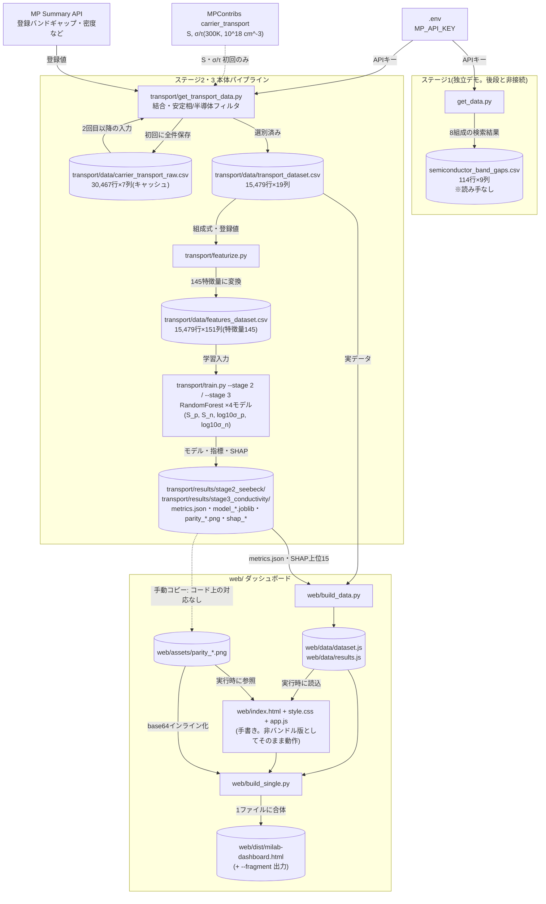

# 00_verify — アーキテクチャ図とコードの突き合わせ

検証対象: [docs/mi-project-architecture.html](../mi-project-architecture.html)(ページタイトル「mi-project データフロー Diagram」、archify 生成のインタラクティブ HTML)。

検証方法: HTML に埋め込まれた SVG から `data-node-id`(11 ノード)と `data-edge-from` / `data-edge-to` / `data-edge-label`(11 エッジ)を機械抽出し、各要素をソースコードおよび実データ(CSV の実測行数・列数、PNG のチェックサム)と突き合わせた。行番号は 2026-09-15 時点の作業ツリー(commit 8a6c36a、クリーン)基準。

## 判定サマリ

- ノード 11 個: 一致 11
- エッジ 11 本: 一致 9、相違 2
- 図にあるがコードに無い要素: 0
- コードにあるが図に無い要素: 7(うちパイプラインに実質関与するもの 5)

**相違・欠落があるため、指示に従いここで作業を停止し、以下の一覧を提示する。**

## ノードの検証

| 図中の要素 | 対応する実体 | 判定 | 根拠 |
|---|---|---|---|
| `.env / MP_API_KEY` | リポジトリルートの `.env`(git 管理外) | 一致 | `transport/get_transport_data.py:31-36` が `load_dotenv` で読み、無ければ例外。`.gitignore:1` |
| `MP Summary API(バンドギャップ・密度など)` | `mp_api.client.MPRester` 経由の `materials.summary.search` | 一致 | `transport/get_transport_data.py:108-124`。取得フィールドに `band_gap`・`density` を含む(116, 119 行) |
| `MPContribs carrier_transport (S, σ)` | `mpcontribs.client.Client` への `query_contributions` | 一致 | `transport/get_transport_data.py:56-71`。`data.S.p/n`、`data.sigma.p/n` を取得(65-68 行) |
| `get_transport_data.py(結合・安定相/半導体フィルタ)` | `transport/get_transport_data.py` | 一致 | 結合 160 行、E_hull ≤ 0.05 フィルタ 165-166 行、band_gap > 0 フィルタ 171 行 |
| `transport_dataset.csv(15,479行 × 19列)` | `transport/data/transport_dataset.csv` | 一致 | 書き出し `get_transport_data.py:184`。実測: 15,479 データ行 × 19 列(`wc -l` / ヘッダ列数で確認) |
| `featurize.py(Magpie統計量 + MP登録値)` | `transport/featurize.py` | 一致 | Magpie 記述子 42-47 行、MP 登録値スカラー `SCALAR_FEATURES` 27-33 行 |
| `features_dataset.csv(15,479行 × 151列)` | `transport/data/features_dataset.csv`(git 管理外) | 一致 | 書き出し `featurize.py:69`。実測: 15,479 データ行 × 151 列(メタ 2 + 目的変数 4 + 特徴量 145) |
| `train.py(RandomForest --stage 2/3)` | `transport/train.py` | 一致 | `RandomForestRegressor` 138-140 行、`--stage {2,3}` 引数 182 行 |
| `transport/results/(metrics.json・model・SHAP)` | `transport/results/stage2_seebeck/`、`stage3_conductivity/` | 一致 | metrics.json 199-200 行、model joblib 159 行、SHAP 出力 106-117 行、パリティ図 156-157 行 |
| `build_data / build_single(CSV・JSON → 埋め込みJS)` | `web/build_data.py` と `web/build_single.py` | 一致 | JS グローバルとして書き出し `build_data.py:50-51, 75-76`。ただし 2 スクリプト間の中間ファイルは図に無い(後述) |
| `milab-dashboard.html(単一ファイル配布)` | `web/dist/milab-dashboard.html` | 一致 | 出力先 `build_single.py:18`、書き出し 57 行 |

補足: エッジ `APIキー` の副ラベル「認証」、エッジ `登録値` の副ラベル「MP本体・特徴量側」はいずれもコードの実態と矛盾しない。

## エッジの検証

| 図中の要素 | 対応する実体 | 判定 | 根拠 |
|---|---|---|---|
| `.env → get_transport_data.py(APIキー)` | `load_dotenv` → `MPRester(API_KEY)` / `Client(apikey=API_KEY)` | 一致 | `get_transport_data.py:32-33, 56, 108` |
| `MP Summary API → get_transport_data.py(登録値)` | `fetch_mp_summary` | 一致 | `get_transport_data.py:100-150` |
| `MPContribs → get_transport_data.py(S・σ)` | `fetch_carrier_transport` | **相違** | API を叩くのは `transport/data/carrier_transport_raw.csv` が存在しない初回のみ。キャッシュがあれば API には接続せず CSV を読む(`get_transport_data.py:52-54`)。このキャッシュファイルと条件分岐が図に描かれていない |
| `get_transport_data.py → transport_dataset.csv(選別済み)` | `df.to_csv(OUTPUT_PATH)` | 一致 | `get_transport_data.py:183-184` |
| `transport_dataset.csv → featurize.py(組成式・登録値)` | `pd.read_csv(INPUT_PATH)`、`formula_pretty` から Magpie 生成 | 一致 | `featurize.py:19, 37, 42-46` |
| `featurize.py → features_dataset.csv(145特徴量に変換)` | `out.to_csv(OUTPUT_PATH)` | 一致 | `featurize.py:56-69`。実測の特徴量列数 145(= Magpie 132 + スカラー 5 + 直接遷移フラグ 1 + 結晶系 one-hot 7)。SHAP ランキング CSV も 145 行 |
| `features_dataset.csv → train.py(学習入力)` | `pd.read_csv(FEATURES_PATH)` | 一致 | `train.py:39, 189` |
| `train.py → transport/results/(モデル・指標・SHAP)` | 各種 `savefig` / `to_csv` / `joblib.dump` / `json.dump` | 一致 | `train.py:94, 108, 117, 156-159, 199-200` |
| `transport/results/ → build_data/build_single(精度指標)` | `build_data.py` が metrics.json と SHAP 重要度 CSV を読む | **相違** | ラベルの「精度指標」に加えて SHAP 重要度 CSV(上位 15 件)も流れる(`build_data.py:62-74`)。さらにパリティ PNG は results/ から直接ではなく `web/assets/` 経由で `build_single.py:31-38` が読むが、この経路が図に無い(後述) |
| `transport_dataset.csv → build_data/build_single(実データ)` | `build_data.py` が直接読む | 一致 | `build_data.py:17` |
| `build_data/build_single → milab-dashboard.html(1ファイルに合体)` | CSS/JS/データ/画像のインライン化 | 一致 | `build_single.py:42-57` |

## コードにあるが図に無い要素

| コード側の実体 | 内容 | 判定 | 根拠 |
|---|---|---|---|
| `get_data.py` + `semiconductor_band_gaps.csv` | ステージ1(バンドギャップのデータ取得、8 組成 → 114 行 × 9 列)。README はこれを 3 ステージ構成の第 1 段と位置づけるが、図には一切登場しない。なおこの CSV を読むコードはリポジトリに存在せず、後段パイプラインとはデータ的に非接続 | コードにあるが図に無い | `get_data.py:20, 103-104`、README.md:107-108。参照検索でヒット 0 |
| `transport/data/carrier_transport_raw.csv` | MPContribs 全件取得の生キャッシュ(30,467 行 × 7 列、git 管理外)。2 回目以降の実行では API の代わりにこれが入力になる | コードにあるが図に無い | 書き込み `get_transport_data.py:95`、読み込み 52-54 行、`.gitignore:9` |
| `web/data/dataset.js`・`web/data/results.js` | `build_data.py` の出力かつ `build_single.py`・`index.html` の入力となる中間ファイル。図では build_data と build_single が 1 ノードに束ねられており、この受け渡しが見えない | コードにあるが図に無い | 書き出し `build_data.py:50-51, 75-76`、読み込み `build_single.py:27-28`、`web/index.html:211-212` |
| `web/index.html`・`web/style.css`・`web/app.js` | 手書きのダッシュボード本体。`build_single.py` の入力であると同時に、**バンドルを経ない非バンドル版ダッシュボードとしてそのまま動く**(README が第一の起動方法として案内)。図の終端が `milab-dashboard.html` のみのため、この経路が存在しないように見える | コードにあるが図に無い | `build_single.py:24-26`、`web/index.html:211-213`、README.md:129-130 |
| `web/assets/parity_*.png` | パリティ図 4 枚。`app.js` が実行時に相対パスで参照し、`build_single.py` が base64 でインライン化する。**transport/results/ の同名 PNG とバイト単位で同一(md5 一致を確認)だが、コピーを行うコードはリポジトリに存在しない**(手動コピーと推定。確定はコードからは判断不能) | コードにあるが図に無い | `web/app.js:58-61`、`build_single.py:31-38`。全 build スクリプトに assets への書き込み処理なし |
| `build_single.py --fragment` 出力 | doctype/head/body 殻なしの埋め込み用フラグメントを任意パスに追加出力する第 2 の成果物 | コードにあるが図に無い | `build_single.py:20-22, 60-68` |
| `docs/make_slides.py` → `mi-project-slides.pptx/pdf` | スライド生成スクリプト。データパイプラインの外側の成果物であり、図の対象範囲外である可能性が高い(意図は作者確認) | コードにあるが図に無い | `docs/make_slides.py`(python-pptx でスライド構築) |

## 図にあるがコードに無い要素

該当なし。抽出した 11 ノード・11 エッジすべてに対応する実体が存在する。

## 3 段階(バンドギャップ → ゼーベック係数 → 電気伝導率)の受け渡し粒度の検証

- **ステージ1 → ステージ2/3**: コード上、ステージ1の成果物(`semiconductor_band_gaps.csv`)を後段が読む箇所は存在しない。後段の特徴量となるバンドギャップは MP Summary API の登録値 `band_gap_mp_eV` であり(`get_transport_data.py:116`、`featurize.py:28`)、図の `MP Summary API → get_transport_data.py` の矢印はこの実態と一致する。ただし図にはステージ1そのものが描かれていないため、「3 ステージ構成」という README の説明単位は図から読み取れない。
- **ステージ2 → ステージ3**: 図にステージ2→3 の矢印は無く、コードでも `train.py` は両ステージとも `features_dataset.csv` のみを入力とし、前段の予測値を特徴量に使わない(`train.py:121-141`、目的変数を 1 つずつ独立に学習)。**カスケード無しという点で図とコードは一致**。
- **粒度の差**: コードではステージ2と3は別々の実行(`--stage 2` / `--stage 3`)・別々の出力ディレクトリ(`stage2_seebeck/`、`stage3_conductivity/`)だが、図では `train.py` 1 ノード・`transport/results/` 1 ノードに統合されている。矢印の向き・内容に誤りは無いが、「4 モデル(S の p/n、log₁₀σ の p/n)が独立に学習される」ことは図からは読めない(`train.py:48-67, 194-197`)。

## 数値主張の実測結果

| 図の主張 | 実測 | 判定 |
|---|---|---|
| transport_dataset.csv = 15,479 行 × 19 列 | 15,479 データ行、19 列 | 一致 |
| features_dataset.csv = 15,479 行 × 151 列 | 15,479 データ行、151 列 | 一致 |
| 145 特徴量に変換 | 151 − メタ 2 − 目的変数 4 = 145。SHAP 重要度 CSV も 145 行 | 一致 |

注意: `featurize.py:66` の `dropna()` により、データを再構築した場合は行数が 15,479 から減り得る(現状は特徴量欠損 0 のため入力と同数)。図の行数は現時点のスナップショットである。

## 修正版アーキテクチャ図(mermaid)

相違 2 件(キャッシュ経路、results→web の内容)と欠落 5 件(ステージ1、生キャッシュ、web 中間 JS、手書きソース経路、assets の手動コピー)を反映した版。

## 作者に確認すべき未解決点(2026-09-15 回答済み)

1. **ステージ1の省略は意図か**(σ 不使用決定は有効か)→ **回答: 残す**。ステージ1・σ とも現行構成のまま維持。以降の解説はステージ1と σ を現行実装として扱う。
2. **`web/assets/parity_*.png` の由来** → **回答: 手動コピーで合っている**。再学習後は `transport/results/*/parity_*.png` を `web/assets/` へ手動でコピーする運用。
3. **図の数値の扱い** → **回答: 維持する**。15,479 等は固定スナップショット値として扱う。
4. **`docs/make_slides.py` の図への包含要否** → 個別回答なし。パイプライン外成果物として図から除外のままとする。
5. **非バンドル版ダッシュボードの位置づけ** → **回答: `web/index.html` が正**。`dist/milab-dashboard.html` は副次的な配布形態。
